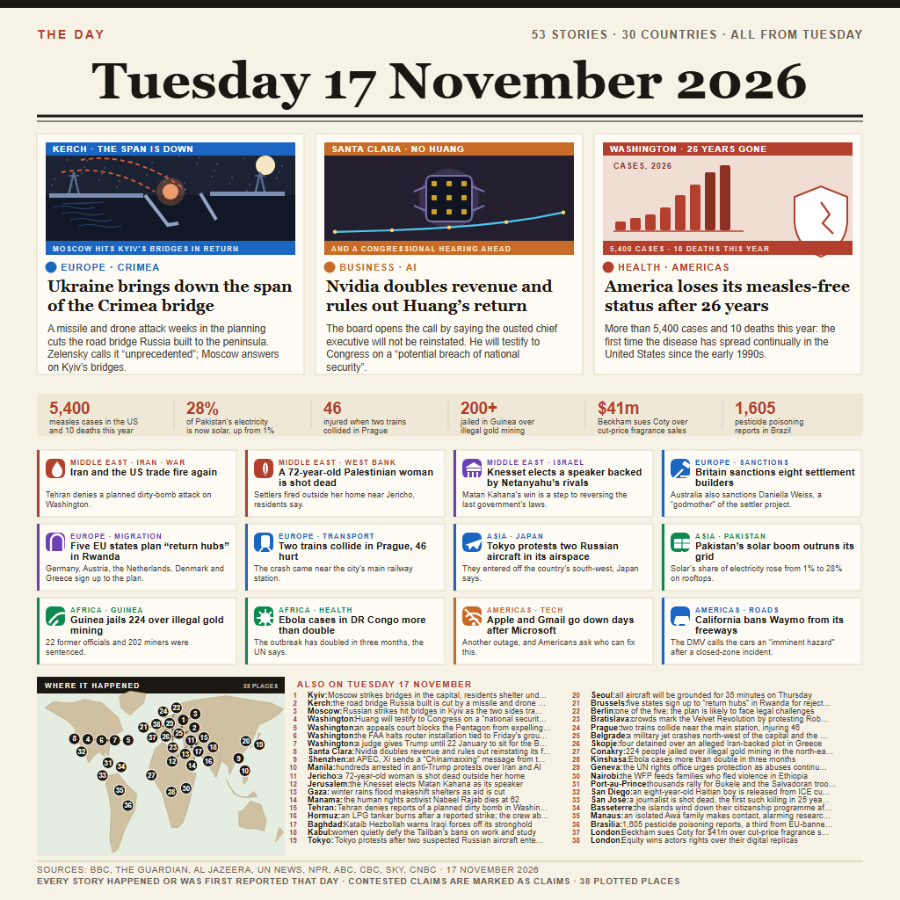

# The Day — 17 November 2026

[](https://make.fun/bounty/news-image-20261117?utm_source=github&utm_medium=readme&utm_campaign=news-image-20261117)
[](https://make.fun/bounty/news-image-20261117/leaderboard?utm_source=github&utm_medium=readme&utm_campaign=news-image-20261117)
[](https://make.fun/bounty/news-image-20261117?utm_source=github&utm_medium=readme&utm_campaign=news-image-20261117)

An entry for [make.fun's](https://make.fun) `news-image-20261117` bounty: one image that
sums up Tuesday 17 November 2026's world news.



## What the plate holds

**53 stories across 30 countries**, every one of them published or first reported on
17 November 2026, and every brief plotted where it happened:

- **3 lead stories, drawn.** The Ukrainian missile and drone attack that brought down a span
  of the Crimea bridge, weeks in the planning, with Moscow answering on Kyiv's bridges;
  Nvidia doubling its revenue while its board ruled out reinstating Jensen Huang, who was
  called to testify to Congress on a "potential breach of national security"; and the United
  States losing its measles elimination status after 26 years, with more than 5,400 cases and
  10 deaths.
- **The numbers of the day**: 5,400 cases and 10 deaths, 28% of Pakistan's electricity now
  solar, 46 hurt in Prague, 224 jailed in Guinea, $41m of Beckham's lawsuit, 1,605 pesticide
  poisonings in Brazil.
- **12 story cards**, each with a headline, one line of context and a drawn icon: the Iran–US
  exchange of fire, the 72-year-old Palestinian woman shot dead near Jericho, the Knesset's
  new speaker, Britain's sanctions on eight settlement builders, the EU's five "return hubs",
  the Prague train crash, Russian aircraft over Japan, Pakistan's solar boom, Guinea's gold
  sentences, Ebola in DR Congo, Apple's outage, and California's ban on Waymo freeways.
- **38 plotted places** on a real map: a hand-built equirectangular projection with the
  continents drawn from their real outlines, one numbered pin per brief at that brief's real
  longitude and latitude, and leader lines where pins crowd.
- **An honest footer**: the sources, the rule that every story happened or was first reported
  that day, and the note that contested claims are marked as claims.

## How it was built

`build_plate.py` draws the page as SVG — the masthead, the three illustrated leads, the
numerals, the cards, the map and its pins. Every text run is measured against the real font
metrics before it is placed, so nothing overflows its box; nothing is clipped, nothing
overlaps. The map is projected from lon/lat, so a pin is where the story was.

```bash
python3 build_plate.py         # writes plate.html
```

`main.py` copies the committed `entry.png` to `/output/entry.png` — byte for byte, so both
runs of the entry write the same file, with no network, clock or random source involved. It
also checks the PNG's magic bytes and its size before copying.

## Checking the day

Every story was checked back against the day's feeds — BBC, The Guardian, Al Jazeera, UN
News, NPR, ABC, CBC, Sky and CNBC — before it was drawn, and where a feed did not carry a
detail the plate drops it: a line about the Kremlin's response went out because no feed
carried one, and the UN human-rights brief is filed from Geneva, where the office sits, not
from the country it was reporting on.

## Licence

MIT — see [LICENSE](LICENSE). The picture is my own work: every mark on it is drawn by
`build_plate.py`, and every story it reports is a fact from a public feed.
